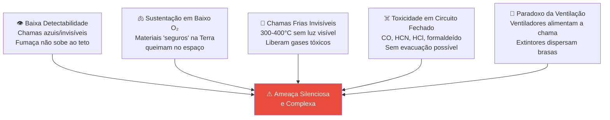
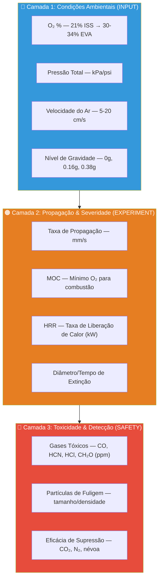
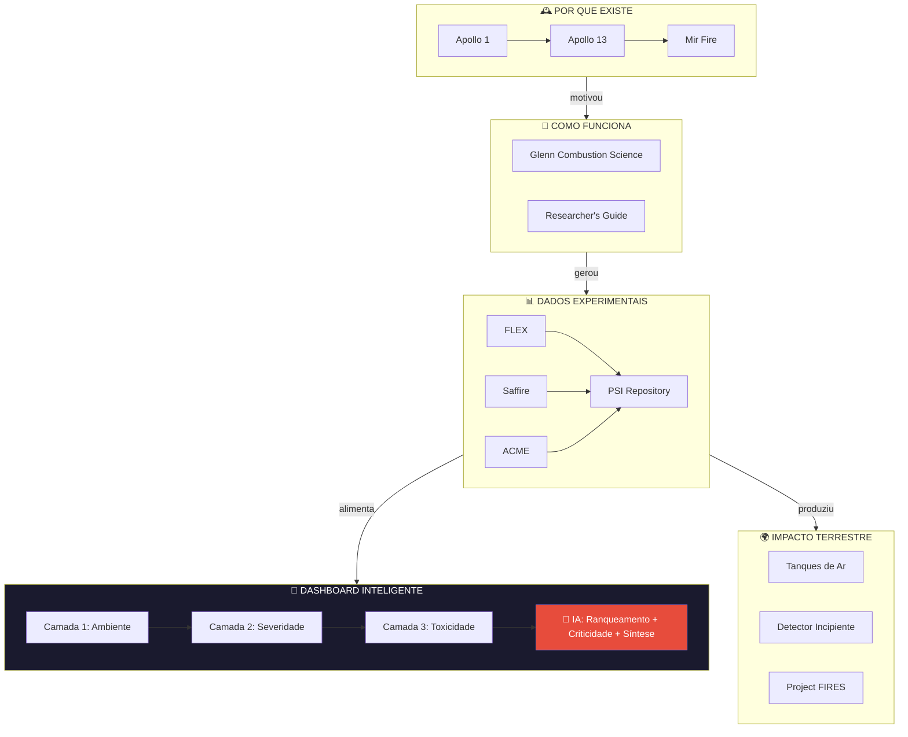

# 🚀 Missão do Dashboard — Análise do Relatório Técnico

## Objetivo Central

> Conceber um **painel interativo (dashboard) potencializado por IA** capaz de **sintetizar, ranquear por criticidade e interpretar** os achados experimentais da NASA, convertendo dados brutos em **recomendações acionáveis** de prevenção, detecção e supressão de incêndios para a exploração espacial humana.

---

## O Problema

| Aspecto | Descrição |
|---------|-----------|
| **Volume** | Décadas de dados experimentais acumulados |
| **Dispersão** | Dados espalhados em múltiplos repositórios e formatos |
| **Complexidade** | Alta barreira técnica para consulta e interpretação |
| **Urgência** | Programa Artemis (Lua) e futuras missões a Marte dependem desses dados |

---

## Física: Terra vs. Microgravidade

| Parâmetro | 🌍 Terra (1g) | 🛸 Espaço (0g) |
|-----------|--------------|----------------|
| **Mecanismo** | Convecção natural (empuxo térmico) | Difusão molecular / ventilação forçada |
| **Geometria da chama** | Lágrima (alongada vertical) | Esférica / hemisférica |
| **Cor / Luminosidade** | Amarela/alaranjada intensa | Azul pálida ou **invisível** |
| **Temperatura** | Elevada (pluma superior) | Mais baixa — **chamas frias (300-400°C)** |
| **Fumaça** | Sobe → acumula no teto | Suspensa em nuvens → segue dutos de ar |

---

## 5 Riscos Críticos em Missões Tripuladas

---

## 3 Programas Experimentais Core (Fontes de Dados)

| Programa | Foco | Ambiente | Dados Chave |
|----------|------|----------|-------------|
| **FLEX** | Gotas de combustível líquido | ISS (CIR) | Transição chama quente → fria, diâmetros de extinção |
| **Saffire** | Materiais sólidos em escala real | Cygnus (pós-ISS) | Propagação, liberação de calor, geração de fumaça |
| **ACME** | Chamas gasosas não pré-misturadas | ISS (CIR) | Estrutura da chama, fuligem, limites de extinção |

---

## Arquitetura de 3 Camadas do Dashboard

### Tabela de Variáveis Prioritárias

| Camada | Variável | Unidade | Relevância |
|--------|----------|---------|------------|
| **1. Ambientais** | Concentração O₂ | % | Inflamabilidade — atmosferas EVA usam 30-34% |
| | Pressão Total | kPa / psi | Hipobárica (56 kPa Lua/Marte) altera difusividade |
| | Velocidade do Ar | cm/s | 5-20 cm/s intensifica transporte de O₂ à chama |
| | Nível de Gravidade | g | Interpolar 0g ↔ 0.16g (Lua) ↔ 0.38g (Marte) |
| **2. Severidade** | Taxa de Propagação | mm/s | Tempo disponível para resposta da tripulação |
| | MOC (Min O₂) | % | Linha de corte para homologação de materiais |
| | HRR (Calor) | kW | Risco de falha estrutural / ignição secundária |
| | Diâmetro de Extinção | mm / s | Limiar de transição para chama fria invisível |
| **3. Segurança** | Gases Tóxicos | ppm | Dimensionar autonomia de máscaras |
| | Partículas de Fuligem | µm / mg/m³ | Calibrar detectores ópticos/ionização |
| | Eficácia de Supressão | L / L/s | Volume de agente sem reignição |

---

## Camada de IA — 3 Funções Inteligentes

| Função | O que faz | Exemplo |
|--------|-----------|---------|
| **🎯 Ranqueamento Dinâmico** | Usuário define perfil de missão (O₂%, pressão, g) → IA reordena materiais do maior ao menor risco | "32% O₂, 56.5 kPa, 0.16g" → lista de materiais ranqueados |
| **⚠️ Índice de Criticidade** | Cruza propagação × MOC × toxicidade → alerta quando material seguro na ISS vira perigoso em Artemis | Material aprovado a 21% O₂ → ALERTA a 34% O₂ |
| **📊 Síntese Comparativa** | Compara automaticamente resultados entre campanhas experimentais → destaca lacunas | Polímero X no Saffire (fluxo forçado) vs. condições quiescentes |

---

## Mapa Completo: Fontes → Dashboard

---

> [!IMPORTANT]
> **Síntese Estratégica:** O sucesso do dashboard depende de conectar a física fundamental da microgravidade (ausência de convecção, chamas esféricas, combustão fria e fumaça não ascendente) diretamente às decisões de projeto de engenharia. Ao estruturar os dados FLEX, Saffire e ACME em torno de atmosfera de cabine, severidade térmica e toxicidade, a IA capacita engenheiros a mitigarem riscos **antes** da seleção final dos materiais de voo.
