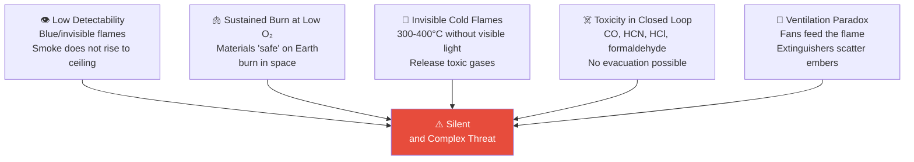
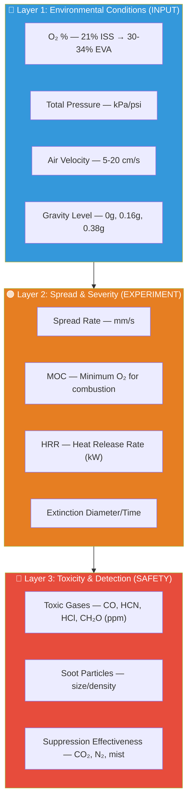

# 🚀 Dashboard Mission — Technical Report Analysis

## Central Objective

> Design an **AI-powered interactive dashboard** capable of **synthesizing, ranking by criticality, and interpreting** NASA experimental findings, turning raw data into **actionable recommendations** for fire prevention, detection, and suppression during human space exploration.

---

## The Problem

| Aspect | Description |
|---------|-----------|
| **Volume** | Decades of accumulated experimental data |
| **Dispersion** | Data scattered across multiple repositories and formats |
| **Complexity** | High technical barrier to query and interpretation |
| **Urgency** | Artemis program (Moon) and future Mars missions depend on this data |

---

## Physics: Earth vs. Microgravity

| Parameter | 🌍 Earth (1g) | 🛸 Space (0g) |
|-----------|--------------|----------------|
| **Mechanism** | Natural convection (thermal buoyancy) | Molecular diffusion / forced ventilation |
| **Flame geometry** | Teardrop (elongated vertical) | Spherical / hemispherical |
| **Color / luminosity** | Intense yellow/orange | Pale blue or **invisible** |
| **Temperature** | High (upper plume) | Lower — **cold flames (300-400°C)** |
| **Smoke** | Rises → accumulates on ceiling | Suspended in clouds → follows air ducts |

---

## 5 Critical Risks in Crewed Missions

---

## 3 Core Experimental Programs (Data Sources)

| Program | Focus | Environment | Key Data |
|----------|------|----------|-------------|
| **FLEX** | Liquid fuel droplets | ISS (CIR) | Hot-to-cold flame transition, extinction diameters |
| **Saffire** | Full-scale solid materials | Cygnus (post-ISS) | Spread, heat release, smoke generation |
| **ACME** | Non-premixed gas flames | ISS (CIR) | Flame structure, soot, extinction limits |

---

## 3-Layer Dashboard Architecture

### Priority Variables Table

| Layer | Variable | Unit | Relevance |
|--------|----------|---------|------------|
| **1. Environmental** | O₂ concentration | % | Flammability — EVA atmospheres use 30-34% |
| | Total pressure | kPa / psi | Hypobaric (56 kPa Moon/Mars) alters diffusivity |
| | Air velocity | cm/s | 5-20 cm/s intensifies O₂ transport to flame |
| | Gravity level | g | Interpolate 0g ↔ 0.16g (Moon) ↔ 0.38g (Mars) |
| **2. Severity** | Spread rate | mm/s | Time available for crew response |
| | MOC (Min O₂) | % | Cutoff line for material qualification |
| | HRR (Heat) | kW | Structural failure / secondary ignition risk |
| | Extinction diameter | mm / s | Threshold for transition to invisible cold flame |
| **3. Safety** | Toxic gases | ppm | Size mask autonomy |
| | Soot particles | µm / mg/m³ | Calibrate optical/ionization detectors |
| | Suppression effectiveness | L / L/s | Agent volume without reignition |

---

## AI Layer — 3 Intelligent Functions

| Function | What it does | Example |
|--------|-----------|---------|
| **🎯 Dynamic Ranking** | User defines mission profile (O₂%, pressure, g) → AI reorders materials from highest to lowest risk | "32% O₂, 56.5 kPa, 0.16g" → ranked material list |
| **⚠️ Criticality Index** | Crosses spread × MOC × toxicity → alert when ISS-safe material becomes Artemis-dangerous | Material approved at 21% O₂ → ALERT at 34% O₂ |
| **📊 Comparative Synthesis** | Automatically compares results across experimental campaigns → highlights gaps | Polymer X in Saffire (forced flow) vs. quiescent conditions |

---

## Full Map: Sources → Dashboard

---

> [!IMPORTANT]
> **Strategic synthesis:** Dashboard success depends on connecting fundamental microgravity physics (no convection, spherical flames, cold combustion, non-rising smoke) directly to engineering design decisions. By structuring FLEX, Saffire, and ACME data around cabin atmosphere, thermal severity, and toxicity, AI enables engineers to mitigate risks **before** final flight material selection.