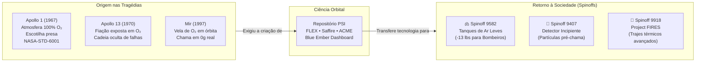

# 🔵🔥 Blue Ember — Relatório Técnico de Engenharia e Arquitetura de Métricas
**Equipe StellarHub · NASA Space Apps Challenge · Novembro/2026**

---

## 1. Visão Executiva e Posicionamento

O **Blue Ember** é um sistema de suporte à decisão de segurança contra incêndios espaciais projetado para transformar o vasto repositório de dados brutos e dispersos da NASA (**Physical Sciences Informatics - PSI**, **NTRS**, **ACCLLP** e **NASA Spinoff**) em inteligência acionável para missões do Programa Artemis (Lua) e futuras expedições a Marte.

O sistema resolve um gargalo crítico: a física do fogo na microgravidade e em atmosferas de exploração enriquecidas com oxigênio difere radicalmente da física terrestre. Ao padronizar experimentos heterogêneos sob uma **Ficha Normalizada**, o Blue Ember aplica algoritmos de avaliação e modelos de linguagem para entregar **respostas baseadas em evidências, com citação direta de experimentos (PSI-xx) e DOIs**.

---

## 2. Fluxo de Decisão em 4 Etapas

```mermaid
flowchart LR
    subgraph ETAPA1["1. Usuário Escolhe (Input)"]
        Q["Pergunta / Decisão de Projeto\n(Material + O₂ + Pressão + Fluxo)"]
        AMB["Ambiente Operacional\n(ISS 0g, Lua 0.16g, Marte 0.38g)"]
        PERF["Perfil de Decisão\n(Engenheiro, Pesquisador, Estudante)"]
    end

    subgraph ETAPA2["2. NASA Fornece (Dados Brutos)"]
        PSI["Investigações PSI-xx\n(FLEX, Saffire, ACME, BASS)"]
        TEST["Bancos de Testes & Sensores\n(CO, CO₂, HRR, MOC, propagação)"]
        PUB["Publicações Científicas\n(NTRS, DOIs de artigos)"]
        SPIN["Impacto na Terra\n(Spinoffs 9582, 9407, 9918)"]
    end

    subgraph ETAPA3["3. Sistema Normaliza (Inovação Blue Ember)"]
        FICHA["Ficha Normalizada Multidimensional\n• Faixa de O₂ (%)\n• Pressão Total (kPa)\n• Velocidade do Fluxo (cm/s)\n• Geometria & Regime de Queima"]
    end

    subgraph ETAPA4["4. Resposta com Evidência"]
        R1["Ranking Crítico (Score 5 Critérios)"]
        R2["Força da Evidência Empírica"]
        R3["Mapeamento de Lacunas (Gaps)"]
        R4["Insight Interpretativo da IA"]
    end

    ETAPA1 --> ETAPA2 --> ETAPA3 --> ETAPA4
```



---

## 3. Engenharia de Métricas: O Score de 5 Critérios

Para ranquear investigações e materiais frente a uma consulta do usuário, o motor calcula um **Índice de Criticidade / Risco ($S$)** normalizado entre 0 e 10, composto por 5 eixos ponderados:

$$S = \sum_{i=1}^{5} w_i \cdot C_i$$

### Especificação dos Critérios ($C_1$ a $C_5$)

| Critério | Variável Base | Escala de Normalização | O que mede e Relevância |
|---|---|---|---|
| **$C_1$: Proximidade Operacional (Environmental Similarity)** | $\Delta O_2, \Delta P, \Delta v$ | $0.0 \text{ a } 1.0$ (distância euclidiana inversa) | Quão próximo os dados empíricos do teste estão da condição solicitada para a cabine da missão. |
| **$C_2$: Margem de Inflamabilidade (MOC Margin)** | $O_{2,\text{amb}} - \text{MOC}$ | $0.0 \text{ (seguro)} \text{ a } 1.0 \text{ (crítico)}$ | Proximidade do Limite Mínimo de Oxigênio. Se $O_2 \ge \text{MOC}$, o risco satura em 1.0. |
| **$C_3$: Cinética de Propagação (Flame Spread)** | Taxa de avanço ($r_f$ em mm/s) | Sigmoide sobre $r_f$ ($0.0 \text{ a } 1.0$) | Velocidade com que o fogo se alastra sobre a superfície sólida, ditando a janela de reação da tripulação. |
| **$C_4$: Severidade Térmica (HRR)** | Taxa de Liberação de Calor (kW) | Logarítmica sobre HRR | Potência térmica gerada; quantifica o perigo de ignição em cadeia de cabos e colapso de anteparas. |
| **$C_5$: Toxicidade em Circuito Fechado (Off-gassing)** | Concentração de CO, HCN, HCl (ppm) | Proporção sobre limites de toxicidade do ECLSS | Risco de saturação dos depuradores de ar e envenenamento dos astronautas antes da evacuação. |

---

### Matriz de Modulação de Pesos ($w_i$) por Perfil

O usuário seleciona seu perfil na Etapa 1, adaptando automaticamente as prioridades do algoritmo de pontuação:

```mermaid
xychart-beta
    title "Distribuição de Pesos do Score por Perfil (%)"
    x-axis ["C1: Proximidade", "C2: Margem MOC", "C3: Propagação", "C4: Calor (HRR)", "C5: Toxicidade"]
    y-axis "Peso (%)" 0 --> 40
    bar [15, 25, 25, 20, 15]
    bar [35, 15, 15, 15, 20]
    bar [20, 20, 20, 20, 20]
```



* 🔵 **Engenheiro de Voo / Missão ($w_{\text{Eng}}$):** Prioridade em **$C_2$ (Margem MOC)** e **$C_3$ (Propagação)**. O objetivo é aprovação/reprovação estrutural e contenção de danos ao veículo.
* 🟢 **Pesquisador Científico ($w_{\text{Pesq}}$):** Prioridade em **$C_1$ (Proximidade dos dados)** e rigor empírico, com ênfase na identificação de lacunas.
* 🟡 **Estudante / Divulgação ($w_{\text{Est}}$):** Pesos uniformemente distribuídos com foco educacional na física do fenômeno e lições históricas.

---

## 4. O Diferencial Competitivo: Módulo de Lacunas (Data Gaps)

> [!IMPORTANT]
> **O Paradoxo da Gravidade Parcial (Lua 0.16g e Marte 0.38g)**
> Quase todo o acervo do PSI é composto por testes em **0g orbital (ISS)** ou **1g terrestre (solo)**. 
> 
> Na microgravidade (0g), a ausência de convecção abafa chamas fracas por sufocamento radiativo. Na Terra (1g), correntes convectivas fortes aceleram a remoção de calor. Em **gravidade parcial (0.16g lunar)**, entretanto, surge um regime intermediário de extremo perigo: há convecção suficiente para renovar o oxigênio, mas lenta o suficiente para não resfriar a zona de combustão.
> 
> Chamas na Lua podem queimar com maior velocidade e sob menores concentrações de $O_2$ do que previsto por modelos puros de 0g.

O Blue Ember não esconde esse limite da ciência; ele **alerta ativamente o engenheiro**:
1. Quantifica o nível de interpolação entre 0g e 1g.
2. Identifica se o material já passou por queima em fluxo forçado correspondente à gravidade alvo.
3. Emite a recomendação de ensaio necessário antes da validação final do componente.

---

## 5. Estrutura da Resposta com Evidência (Template de Saída)

Quando o usuário consulta o sistema, todos os fluxos confluem para uma visualização única e estruturada:

````carousel
```markdown
### 🏆 1. Ranking de Investigações & Materiais
- **1º Lugar: Saffire-II (PSI-142)** | Score: 8.7/10 (Risco Elevado)
  - Material: PMMA (Plexiglas) 50mm sob fluxo forçado de 15 cm/s.
  - Taxa de Propagação: 2.1 mm/s | MOC: 16.5% O₂.
- **2º Lugar: BASS-II (PSI-25)** | Score: 5.4/10 (Risco Moderado)
  - Material: Mistura Algodão/Fibra de Vidro (Nomex blend).
  - Comportamento: Autoextinção rápida sob pressão hipobárica.
```
<!-- slide -->
```markdown
### 📏 2. Força da Evidência Empírica
- **Confiabilidade Global:** ALTA para microgravidade (0g), MODERADA para solo (1g).
- **Volume de Dados Correlatos:** 22 pontos de teste documentados no PSI com O₂ entre 28% e 34%.
- **Ambiente:** Testado em voo real a bordo do cargueiro não tripulado Cygnus (Saffire).
```
<!-- slide -->
```markdown
### 🕳️ 3. Mapeamento de Lacunas (Gaps)
- ⚠️ **Alerta Gravitacional:** Sem dados empíricos no PSI para gravidade lunar (0.16g). Os valores apresentados são projeções numéricas validadas apenas em 0g.
- ⚠️ **Toxicidade Incompleta:** Taxa de emissão de HCN para amostras envelhecidas por radiação não consta nos relatórios públicos do NTRS.
```
<!-- slide -->
```markdown
### 💡 4. Parecer Técnico da IA (com Citação)
"O uso de PMMA a 30% de O₂ em atmosfera lunar (56 kPa) excede a margem de segurança recomendada pela NASA-STD-6001. Experimentos da campanha Saffire demonstram aceleração superior a 80% na taxa de propagação de chama quando o O₂ é elevado de 21% para 30% sob fluxo de ar residual de ventilação. Recomenda-se substituição por polímero autoextinguível ou instalação de barreira retardante Nomex.

Fontes Primárias:
- NASA PSI Investigation: PSI-142 (Saffire Project Archive)
- Artigo Original: Urban, D. et al., 'Flame Spread in Low-Gravity Environments', DOI: 10.1016/j.proci.2018.06.198
- Relatório Técnico NTRS: NASA/TM-2020-5008451"
```
````

---

## 6. Trilha de Contexto Histórico e Impacto Social (Spinoffs)

O Blue Ember conecta a decisão técnica ao arco completo de inovação da NASA:



---

## 7. Arquitetura de Implementação Recomendada (`blue-ember`)

Para materializar o projeto no diretório do workspace, propõe-se a seguinte estrutura limpa e modular:

```
blue-ember/
├── data/
│   ├── psi_investigations.json     # Metadados de FLEX, Saffire, ACME, BASS com DOIs
│   ├── normalized_tests.json       # Fichas normalizadas com variáveis unificadas
│   ├── spinoffs.json               # Dados dos Spinoffs 9582, 9407, 9918
│   └── historical_lessons.json     # Apollo 1, 13 e Mir (ACCLLP)
├── src/
│   ├── engine/
│   │   ├── normalizer.ts           # Mapeador de variáveis heterogêneas
│   │   ├── risk_score.ts           # Cálculo dos 5 critérios e ponderação por perfil
│   │   └── gap_detector.ts         # Identificador de lacunas (gravidade parcial / dados faltantes)
│   ├── components/
│   │   ├── QueryConsole.tsx        # Seletores de Entrada (Pergunta, Ambiente, Perfil)
│   │   ├── EvidenceCard.tsx        # Exibição do Ranking com Score 5-Critérios
│   │   ├── GapBanner.tsx           # Alertas de lacunas em gravidade parcial
│   │   ├── MetricsChart.tsx        # Gráficos de O₂ vs Propagação e Toxicidade
│   │   └── SpinoffTimeline.tsx     # Conexão histórica e impacto terrestre
│   └── app/                        # Next.js / Vite React Dashboard
└── README.md
```

---

> [!TIP]
> **Síntese de Valor para a Banca Avaliadora:**
> O Blue Ember não é apenas um "visualizador de dados do PSI". Ele é um **motor de engenharia preditiva**. Ele resolve o problema do excesso de dados criando uma camada de normalização inédita, alertando onde os dados da NASA terminam (as lacunas de gravidade parcial) e protegendo a vida dos futuros astronautas que caminharão na Lua e em Marte.
