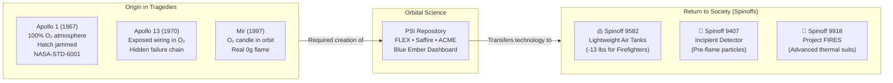

# 🔵🔥 Blue Ember — Engineering and Metrics Architecture Technical Report
**StellarHub Team · NASA Space Apps Challenge · November 2026**

---

## 1. Executive Vision and Positioning

**Blue Ember** is a space fire-safety decision-support system designed to transform NASA's vast repository of raw, scattered data (**Physical Sciences Informatics - PSI**, **NTRS**, **ACCLLP**, and **NASA Spinoff**) into actionable intelligence for Artemis program missions (Moon) and future Mars expeditions.

The system solves a critical bottleneck: fire physics in microgravity and oxygen-enriched exploration atmospheres differs radically from terrestrial physics. By standardizing heterogeneous experiments under a **Normalized Record**, Blue Ember applies scoring algorithms and language models to deliver **evidence-based answers with direct citation of experiments (PSI-xx) and DOIs**.

---

## 2. 4-Step Decision Flow

```mermaid
flowchart LR
    subgraph ETAPA1["1. User Chooses (Input)"]
        Q["Question / Design Decision\n(Material + O₂ + Pressure + Flow)"]
        AMB["Operational Environment\n(ISS 0g, Moon 0.16g, Mars 0.38g)"]
        PERF["Decision Profile\n(Engineer, Researcher, Student)"]
    end

    subgraph ETAPA2["2. NASA Provides (Raw Data)"]
        PSI["PSI-xx Investigations\n(FLEX, Saffire, ACME, BASS)"]
        TEST["Test Banks & Sensors\n(CO, CO₂, HRR, MOC, spread)"]
        PUB["Scientific Publications\n(NTRS, article DOIs)"]
        SPIN["Terrestrial Impact\n(Spinoffs 9582, 9407, 9918)"]
    end

    subgraph ETAPA3["3. System Normalizes (Blue Ember Innovation)"]
        FICHA["Multidimensional Normalized Record\n• O₂ range (%)\n• Total Pressure (kPa)\n• Flow Velocity (cm/s)\n• Geometry & Burn Regime"]
    end

    subgraph ETAPA4["4. Evidence-Based Response"]
        R1["Critical Ranking (5-Criteria Score)"]
        R2["Empirical Evidence Strength"]
        R3["Gap Mapping (Gaps)"]
        R4["AI Interpretive Insight"]
    end

    ETAPA1 --> ETAPA2 --> ETAPA3 --> ETAPA4
```



---

## 3. Metrics Engineering: The 5-Criteria Score

To rank investigations and materials against a user query, the engine computes a **Criticality / Risk Index ($S$)** normalized between 0 and 10, composed of 5 weighted axes:

$$S = \sum_{i=1}^{5} w_i \cdot C_i$$

### Criterion Specification ($C_1$ to $C_5$)

| Criterion | Base Variable | Normalization Scale | What it measures and relevance |
|---|---|---|---|
| **$C_1$: Operational Proximity (Environmental Similarity)** | $\Delta O_2, \Delta P, \Delta v$ | $0.0 \text{ to } 1.0$ (inverse Euclidean distance) | How close empirical test data are to the requested mission cabin condition. |
| **$C_2$: Flammability Margin (MOC Margin)** | $O_{2,\text{amb}} - \text{MOC}$ | $0.0 \text{ (safe)} \text{ to } 1.0 \text{ (critical)}$ | Proximity to Minimum Oxygen Limit. If $O_2 \ge \text{MOC}$, risk saturates at 1.0. |
| **$C_3$: Propagation Kinetics (Flame Spread)** | Advance rate ($r_f$ in mm/s) | Sigmoid over $r_f$ ($0.0 \text{ to } 1.0$) | Speed at which fire spreads over solid surface, dictating crew reaction window. |
| **$C_4$: Thermal Severity (HRR)** | Heat Release Rate (kW) | Logarithmic over HRR | Thermal power generated; quantifies cable chain ignition and bulkhead collapse hazard. |
| **$C_5$: Closed-Loop Toxicity (Off-gassing)** | CO, HCN, HCl concentration (ppm) | Ratio over ECLSS toxicity limits | Risk of air scrubber saturation and astronaut poisoning before evacuation. |

---

### Weight Modulation Matrix ($w_i$) by Profile

The user selects their profile in Step 1, automatically adapting scoring algorithm priorities:

```mermaid
xychart-beta
    title "Score Weight Distribution by Profile (%)"
    x-axis ["C1: Proximity", "C2: MOC Margin", "C3: Spread", "C4: Heat (HRR)", "C5: Toxicity"]
    y-axis "Weight (%)" 0 --> 40
    bar [15, 25, 25, 20, 15]
    bar [35, 15, 15, 15, 20]
    bar [20, 20, 20, 20, 20]
```



* 🔵 **Flight / Mission Engineer ($w_{\text{Eng}}$):** Priority on **$C_2$ (MOC Margin)** and **$C_3$ (Spread)**. Goal is structural pass/fail and vehicle damage containment.
* 🟢 **Scientific Researcher ($w_{\text{Pesq}}$):** Priority on **$C_1$ (Data proximity)** and empirical rigor, emphasizing gap identification.
* 🟡 **Student / Outreach ($w_{\text{Est}}$):** Uniformly distributed weights with educational focus on phenomenon physics and historical lessons.

---

## 4. Competitive Differentiator: Gaps Module (Data Gaps)

> [!IMPORTANT]
> **The Partial Gravity Paradox (Moon 0.16g and Mars 0.38g)**
> Nearly the entire PSI archive consists of tests in **orbital 0g (ISS)** or **terrestrial 1g (ground)**. 
> 
> In microgravity (0g), lack of convection smothers weak flames by radiative quenching. On Earth (1g), strong convective currents accelerate heat removal. In **partial gravity (0.16g lunar)**, however, an intermediate regime of extreme danger emerges: there is enough convection to renew oxygen, but slow enough not to cool the combustion zone.
> 
> Flames on the Moon can burn faster and at lower $O_2$ concentrations than predicted by pure 0g models.

Blue Ember does not hide this scientific limit; it **actively alerts the engineer**:
1. Quantifies interpolation level between 0g and 1g.
2. Identifies whether the material has been burned in forced flow corresponding to target gravity.
3. Issues the test recommendation needed before final component validation.

---

## 5. Evidence Response Structure (Output Template)

When the user queries the system, all flows converge on a single structured view:

````carousel
```markdown
### 🏆 1. Investigation & Material Ranking
- **1st: Saffire-II (PSI-142)** | Score: 8.7/10 (High Risk)
  - Material: PMMA (Plexiglas) 50mm under 15 cm/s forced flow.
  - Spread Rate: 2.1 mm/s | MOC: 16.5% O₂.
- **2nd: BASS-II (PSI-25)** | Score: 5.4/10 (Moderate Risk)
  - Material: Cotton/Glass Fiber blend (Nomex blend).
  - Behavior: Rapid self-extinction under hypobaric pressure.
```
<!-- slide -->
```markdown
### 📏 2. Empirical Evidence Strength
- **Overall Reliability:** HIGH for microgravity (0g), MODERATE for ground (1g).
- **Correlated Data Volume:** 22 documented PSI test points with O₂ between 28% and 34%.
- **Environment:** Tested in actual flight aboard uncrewed Cygnus cargo vehicle (Saffire).
```
<!-- slide -->
```markdown
### 🕳️ 3. Gap Mapping (Gaps)
- ⚠️ **Gravity Alert:** No empirical PSI data for lunar gravity (0.16g). Values shown are numerical projections validated only at 0g.
- ⚠️ **Incomplete Toxicity:** HCN emission rate for radiation-aged samples not in public NTRS reports.
```
<!-- slide -->
```markdown
### 💡 4. AI Technical Opinion (with Citation)
"Use of PMMA at 30% O₂ in lunar atmosphere (56 kPa) exceeds the safety margin recommended by NASA-STD-6001. Saffire campaign experiments demonstrate over 80% acceleration in flame spread rate when O₂ is raised from 21% to 30% under residual ventilation air flow. Self-extinguishing polymer replacement or Nomex retardant barrier installation is recommended.

Primary Sources:
- NASA PSI Investigation: PSI-142 (Saffire Project Archive)
- Original Article: Urban, D. et al., 'Flame Spread in Low-Gravity Environments', DOI: 10.1016/j.proci.2018.06.198
- NTRS Technical Report: NASA/TM-2020-5008451"
```
````

---

## 6. Historical Context and Social Impact Trail (Spinoffs)

Blue Ember connects technical decisions to NASA's full innovation arc:



---

## 7. Recommended Implementation Architecture (`blue-ember`)

To materialize the project in the workspace directory, the following clean, modular structure is proposed:

```
blue-ember/
├── data/
│   ├── psi_investigations.json     # FLEX, Saffire, ACME, BASS metadata with DOIs
│   ├── normalized_tests.json       # Normalized records with unified variables
│   ├── spinoffs.json               # Spinoffs 9582, 9407, 9918 data
│   └── historical_lessons.json     # Apollo 1, 13 and Mir (ACCLLP)
├── src/
│   ├── engine/
│   │   ├── normalizer.ts           # Heterogeneous variable mapper
│   │   ├── risk_score.ts           # 5-criteria calculation and profile weighting
│   │   └── gap_detector.ts         # Gap identifier (partial gravity / missing data)
│   ├── components/
│   │   ├── QueryConsole.tsx        # Input selectors (Question, Environment, Profile)
│   │   ├── EvidenceCard.tsx        # Ranking display with 5-Criteria Score
│   │   ├── GapBanner.tsx           # Partial-gravity gap alerts
│   │   ├── MetricsChart.tsx        # O₂ vs Spread and Toxicity charts
│   │   └── SpinoffTimeline.tsx     # Historical connection and terrestrial impact
│   └── app/                        # Next.js / Vite React Dashboard
└── README.md
```

---

> [!TIP]
> **Value synthesis for judges:**
> Blue Ember is not merely a "PSI data viewer." It is a **predictive engineering engine**. It solves data overload by creating a novel normalization layer, alerting where NASA data ends (partial-gravity gaps), and protecting the lives of future astronauts who will walk on the Moon and Mars.